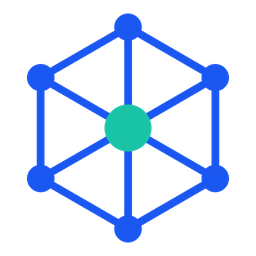
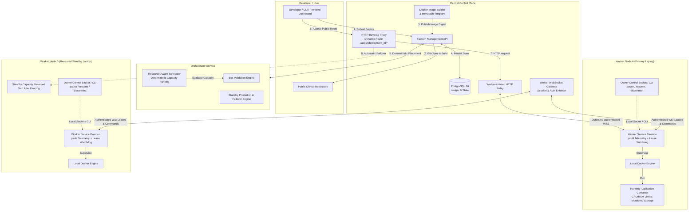
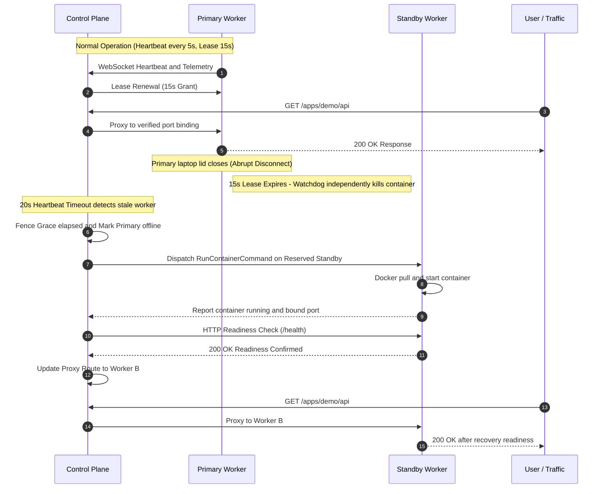

<p align="center">
  
</p>

<h1 align="center">Lattice</h1>

[](https://www.python.org/)
[](https://fastapi.tiangolo.com/)
[](https://nextjs.org/)
[](https://www.docker.com/)
[](https://www.postgresql.org/)
[](https://developer.mozilla.org/en-US/docs/Web/API/WebSockets_API)
[](docs/integration-review.md)
[]()
[](LICENSE)

> *A distributed application-hosting platform that transforms unused computing resources from personal laptops and desktop computers into a resilient, peer-contributed cloud hosting network.*

---

## 📑 Table of Contents

- [1. Overview & Vision](#1-overview--vision)
- [2. System Architecture](#2-system-architecture)
- [3. Core Module Responsibilities](#3-core-module-responsibilities)
- [4. Key Capabilities & Engineering Highlights](#4-key-capabilities--engineering-highlights)
- [5. Automated Deployment Pipeline](#5-automated-deployment-pipeline)
- [6. Intelligent Scheduling & "Box" Model](#6-intelligent-scheduling--box-model)
- [7. Fault Tolerance, Heartbeats & Split-Brain Fencing](#7-fault-tolerance-heartbeats--split-brain-fencing)
- [8. Contributor Sovereignty: Worker Owner CLI](#8-contributor-sovereignty-worker-owner-cli)
- [9. Quickstart: Running Locally](#9-quickstart-running-locally)
- [10. Running on Physical Distributed Laptops](#10-running-on-physical-distributed-laptops)
- [11. Frontend Dashboard Setup & Features](#11-frontend-dashboard-setup--features)
- [12. Live Demonstration Guide](#12-live-demonstration-guide)
- [13. API Reference](#13-api-reference)
- [14. Verification, Testing & Code Quality](#14-verification-testing--code-quality)
- [15. Operational Limits & Architectural Boundaries](#15-operational-limits--architectural-boundaries)
- [16. License](#16-license)

---

## 1. Overview & Vision

Deploying web applications typically requires relying on centralized cloud giants like AWS, Google Cloud, Azure, or platforms like Render. At the same time, millions of personal computers, developer laptops, and workstations sit with vast amounts of idle CPU cores, unallocated RAM, and excess network bandwidth.

**Lattice** bridges this gap by democratizing cloud infrastructure:
- **Zero Centralized Virtual Machines**: Applications execute inside resource-constrained Docker containers directly across contributor laptops.
- **Git-to-Cloud Simplicity**: Developers provide a public GitHub URL; the platform clones, automatically detects the application stack (Python/FastAPI, Node.js/Express, or custom Dockerfiles), builds an immutable container image, and orchestrates deployment.
- **Zero Simulation / Real Distributed Execution**: No synthetic stubs or mock schedulers. Lattice features real Docker runtime isolation, cgroups resource caps, authenticated WebSocket bi-directional channels, PostgreSQL transactional ledgers, and dynamic reverse-proxy routing with fenced standby recovery when enabled.
- **Developer-Centric Experience**:
  - **ngrok-inspired onboarding**: Pool-scoped machine enrollment using dynamic join tokens (`lattice connect`).
  - **Vercel-inspired deployment experience**: Automated Git repository builds, deployment progression tracking, live streaming logs, and deployment history dashboards.
  - **Modern infrastructure monitoring**: Real-time fleet telemetry, multi-worker graphical metric visualization with hover grayscale isolation, and resource allocation controls.

---

## 2. System Architecture

The platform is designed around a decoupled, highly cohesive distributed architecture:



---

## 3. Core Module Responsibilities

| Component | Directory | Core Responsibilities |
| :--- | :--- | :--- |
| **Frontend Dashboard** | `frontend/` | • Next.js 14 App Router dashboard with dark-first infrastructure design (`#090a0f`, `#111218`).<br>• Real-time multi-worker graphical telemetry with hover grayscale isolation.<br>• ngrok-inspired connection pool empty states with dynamic join snippets.<br>• 5-step Vercel-inspired GitHub deployment wizard with stack detection.<br>• Production deployment details, lifecycle stepper, HTTP readiness verification, and streaming terminal logs. |
| **Control Plane** | `backend/control_plane/` | • FastAPI HTTP REST API with Bearer token authentication.<br>• PostgreSQL database with versioned migrations and advisory locking (`172917, 1`).<br>• Secure Git cloning, Docker build pipeline, and container registry publishing.<br>• Authenticated WebSocket gateway for bi-directional worker command dispatch.<br>• Traffic reverse proxy (`/apps/{deployment_id}/{path}`) with real readiness probing.<br>• Orchestrating graceful recovery, worker pools, and failover workflows. |
| **Worker Service** | `backend/worker_agent/` | • Background daemon running on contributor laptops/PCs.<br>• Local Docker Engine supervisor enforcing CPU/memory limits and monitoring local volume budgets.<br>• Host readings via `psutil`, Docker capacity snapshots, and heartbeat/lease health. CPU/RAM utilization, battery and numeric health history are not exposed by the management API.<br>• Periodic heartbeats (5s) and independent execution lease watchdog (15s).<br>• Workload fencing on disconnection to prevent split-brain execution.<br>• Private journal & state directory (`0700`/`0600`) with request deduplication.<br>• Contributor owner CLI (`status`, `pause`, `resume`, `disconnect`). |
| **Orchestrator** | `backend/orchestrator/` | • Pure, deterministic Python scheduling and capacity verification.<br>• Box capacity validation (ensuring a workload fits entirely on one node).<br>• Multi-worker placement using deterministic capacity-aware ranking.<br>• Capacity ledger reconciliation (distinguishing active vs. idle reservations).<br>• Standby reservation funding and deterministic failover decisions. |
| **Shared Contracts** | `backend/shared/` | • Strictly typed Pydantic v2 schemas and validation models.<br>• Binary unit standards (GiB / MiB) and strict ISO 8601 UTC datetimes.<br>• WebSocket discriminator frames (`run_container`, `heartbeat`, `lease`, etc.). |

---

## 4. Key Capabilities & Engineering Highlights

### 🔒 Enterprise-Grade Security & Isolation
- **HMAC-SHA256 Token Storage**: Worker authentication tokens are hashed in PostgreSQL; plaintext tokens are never exposed in logs or DB dumps.
- **Header-Only Authentication**: WebSockets require `Authorization: Bearer <token>`, `X-Worker-ID`, and `X-Worker-Lease-Enforced: true`. Query-string tokens are rejected.
- **Non-root Workload Execution**: Built application images run under non-root UID `65532`, with read-only root filesystems and writable mounts strictly confined to `/data` and `/tmp`.
- **Docker Cgroups Enforced**: Workloads are strictly governed by CPU quotas (`--cpus`) and RAM hard limits (`--memory`), enforcing configured application budgets.

### ⚡ True Distributed State & Resilience
- **Transactional Ledger Locking**: PostgreSQL row-level locks on workers prevent race conditions and overbooking during concurrent Box creation.
- **Single-Controller Advisory Lock**: Prevents dual-controller split-brain writes on the same database.
- **Deterministic Replay & Idempotency**: Worker state journals deduplicate execution commands; replayed requests never launch duplicate containers.

---

## 5. Automated Deployment Pipeline

When a developer connects a repository, the automated pipeline transitions through strictly verified states:

```
[Requested] ➔ [Cloning Git] ➔ [Detecting Type] ➔ [Building Docker Image]
    ➔ [Publishing Digest] ➔ [Orchestrator Placement] ➔ [Worker Dispatch]
    ➔ [Docker Start] ➔ [HTTP Readiness Probe] ➔ [Active & Routed (Running)]
```

1. **Clone**: The Control Plane pulls the requested branch from public Git providers.
2. **Detect**: Automatically identifies the stack:
   - `requirements.txt` / `pyproject.toml` ➔ **Python (FastAPI / Uvicorn)**
   - `package.json` ➔ **Node.js (Express / NPM start)**
   - `Dockerfile` ➔ Custom developer container definition
   - *Optional:* `lattice.json` in repository root for explicit `start_command`, `internal_port`, and `readiness_path`.
3. **Build & Publish**: The Control Plane builds an architecture-specific Docker image and pushes it with an immutable sha256 digest to the container registry.
4. **Place**: The Orchestrator selects an eligible primary worker; failover-enabled Boxes also reserve a distinct standby worker.
5. **Start & Verify**: The Worker Service pulls the image, configures cgroups limits, and starts the container.
6. **Readiness Probe**: The Control Plane queries the application's readiness endpoint (e.g. `/health`). Only after successful HTTP readiness (2xx/3xx) and container inspection is the public proxy route activated.

---

## 6. Intelligent Scheduling & "Box" Model

A **Box** is an explicit computing reservation unit that encapsulates the execution requirements for an application:
- `cpu_limit_cores` (e.g., `1.0` cores)
- `ram_limit_gb` (e.g., `1.0` GiB)
- `storage_limit_gb` (e.g., `5.0` GiB)
- `eligible_worker_ids` (List of workers allowed to host this Box)
- `failover_enabled` (Whether a distinct standby worker must reserve backup capacity)

### The Placement Scoring Function
Eligible workers are filtered by online status, architecture/runtime compatibility and available resources after reservations. Ranking is deterministic: fewer occupied container slots, then greater available RAM, CPU and storage, with worker ID as the final tie-breaker. Deployment selection prefers the designated primary and then its funded standby.

- **Dual-Worker Guarantee**: For failover-enabled Boxes, the primary workload and the standby reservation are placed on **distinct worker identities**; physical independence requires separate hosts.
- **No Overbooking**: Free capacity telemetry subtracts existing idle reservations so that a worker never commits resources it cannot deliver.

---

## 7. Fault Tolerance, Heartbeats & Split-Brain Fencing

A major challenge in peer-to-peer cloud computing is handling machines going offline (closing laptop lid, Wi-Fi disconnection, sleep mode).



1. **Short Heartbeats (5s) & Bounded Leases (15s)**: Workers must continuously renew their execution lease.
2. **Autonomous Worker Watchdog**: After a lost control connection, the watchdog fences owned workloads when their execution lease expires (15-second default), assuming the worker and Docker remain operational.
3. **Controller Fence Grace (75s)**: The Control Plane waits for the worker's maximum lease plus clock skew before re-allocating the workload on the Standby worker, before dispatching a replacement. This is not external power or storage fencing.

---

## 8. Contributor Sovereignty: Worker Owner CLI

Contributors maintain absolute sovereignty over their hardware. Owner controls use a private Unix socket on macOS/Linux and authenticated loopback RPC on Windows:

```bash
# Check local worker health, active containers, and lease status
PYTHONPATH=backend python -m worker_agent.main status

# Pause admissions and freeze owned running containers
PYTHONPATH=backend python -m worker_agent.main pause

# Resume normal availability
PYTHONPATH=backend python -m worker_agent.main resume

# Graceful drain: alerts Control Plane, stops workloads safely, and disconnects
PYTHONPATH=backend python -m worker_agent.main disconnect
```

---

## 9. Quickstart: Running Locally

Use Python 3.12 and a Linux-container Docker Engine/Desktop. Clone the repository
and install the project in a local environment:

```bash
git clone https://github.com/siddharthjha123/Lattice.git
cd Lattice
git switch main
python3.12 -m venv .venv
source .venv/bin/activate
python -m pip install -r requirements.txt
python -m pip install --no-deps -e .
```

Follow [WALKTHROUGH.md](WALKTHROUGH.md) for fresh local PostgreSQL/registry setup,
private configuration, authenticated worker provisioning and curl examples.
Keep configuration in a private `.env` without overwriting an existing file. Migrations
require explicitly exported configuration; the server runner loads its private
file directly:

```bash
# After preparing/exporting the intended local configuration:
PYTHONPATH=backend python -m control_plane.database.init_db
PYTHONPATH=backend python -m control_plane.run --env-file .env
```

Run one controller per database. PostgreSQL advisory locking rejects a second
controller. Use the guarded migration instructions for an existing cloud
database instead of treating it as a fresh local instance. Local API docs are
available when `EXPOSE_API_DOCS=true`; the configured public profile disables
them. See [.env.example](.env.example), the
[Control Plane guide](backend/control_plane/README.md),
[Worker guide](backend/worker_agent/README.md) and [shared contracts](docs/contracts.md).

---

## 10. Running on Physical Distributed Laptops

Configure a controller origin reachable by your workers, such as
`https://api.example.com` (replace this example with your own hostname), using
Cloudflare Tunnel and PostgreSQL. External database connections should verify
the provider CA and hostname. Admin credentials stay in the controller's private configuration.

Pools, enrollment codes, the installable `lattice` CLI, live monitoring, native
Windows controls and a worker-initiated HTTP relay are implemented. Workers
connect outbound over authenticated WSS without public inbound worker ports.
Follow the [manual milestone](docs/backend-milestone.md) and the
[Windows PowerShell guide](docs/windows-worker.md) for current commands:

```bash
# Operator on the controller, after its configuration is prepared:
lattice monitor --env-file .env --pool-name development

# On an installed worker; enter the code privately when first enrolling:
lattice connect --server https://api.example.com --pool-name development
```

Application URLs currently use `/apps/<deployment-id>/` on the controller origin.
Optional app-host routing requires wildcard DNS/tunnel/certificate setup and
`APP_DOMAIN`. Private GHCR images require read-only access on each worker; the
publisher credential stays on the controller. See [registry setup](docs/image-registry-setup.md).

---

## 11. Frontend Dashboard Setup & Features

The complete web dashboard is built in [frontend/](frontend/) using **Next.js 14 App Router**, **TypeScript**, **Tailwind CSS**, and **shadcn/ui**.

### Key Pages & Capabilities
- **Overview Dashboard (`/dashboard`)**: Fleet summary, live aggregate CPU/RAM capacity, active workers, provisioned Boxes, and recent deployments.
- **Connection Pools (`/pools`, `/pools/[poolId]`)**: Visual directory of compute pools. When a pool is waiting for workers, it displays an empty state with a dynamic copyable join command (`lattice connect`). When computers connect, cards automatically appear with reported Docker specs and available capacity.
- **Compute Box Manager (`/pools/[poolId]/boxes`)**: Enforces strict allocation validation requiring $\ge 2$ connected workers before allowing Box creation.
- **Vercel-Inspired GitHub Deployments (`/deployments`, `/deployments/new`, `/deployments/[deploymentId]`)**:
  - 5-step deployment wizard with GitHub repository inspection, branch selection, automatic stack detection, eligible Box mapping, and build environment configuration.
  - Deployment progression stepper (`Queued → Building → Publishing → Starting → Checking Readiness → Ready`).
  - True reverse-proxy route linking directly to `/apps/{deployment_id}/`.
  - Bounded terminal log viewer with category filters (Build, Runtime, Events), search, and log download.
- **Projects Directory (`/projects/[projectId]`)**: Group deployments by repository with production vs. preview deployment badges.
- **Platform Settings (`/settings`)**: Live Control Plane `/health` connectivity test and management Bearer token held in the browser tab session.

### Local Frontend Startup

```bash
cd frontend
pnpm install
pnpm dev
```

Open [http://localhost:3000](http://localhost:3000) to view the live dashboard.

For production builds:
```bash
cd frontend
pnpm build
pnpm start
```

The dashboard now uses real pool, worker, Box and deployment endpoints through
a restricted same-origin proxy, with verified operator sessions and explicit
empty preview mode. Pool codes are server-issued; join/install commands match
the existing CLI. Framer Motion adds restrained transitions while preserving the
original animated logo. Tests/build and browser fixture flows are documented in
[frontend integration evidence](docs/frontend-integration.md). Real controller
reads were verified; live mutation trials are separate. See
[frontend setup](frontend/README.md) and [contract limits](frontend/MISSING_ENDPOINTS.md).

---

## 12. Live Demonstration Guide

Use this as a demonstration plan. Physical-laptop failover needs its own validation; recovery includes fencing, startup and readiness delays.

| Step | Action | What to Observe | Proves |
| :---: | :--- | :--- | :--- |
| **1** | **Connect 2 Laptops** | Start Worker Service on Laptop A and Laptop B. Check `GET /api/workers` or dashboard. | Real telemetry: live CPU cores, RAM, and hardware metrics from separate machines. |
| **2** | **Deploy from GitHub** | Submit public repo URL to `POST /api/deployments` or via UI wizard. | Fully automated Git clone, Docker build, registry push, and container creation. |
| **3** | **Show Scheduling** | Inspect deployment placement. | Orchestrator placed primary on Laptop A and reserved standby capacity on Laptop B based on capacity scoring. |
| **4** | **Access Live URL** | Open `http://<control_plane>:8000/apps/<id>/` from a phone or browser. | Functional reverse proxy routing through dynamic port bindings to the container. |
| **5** | **Simulate Failure** | Close Laptop A lid or kill Worker 1 process. | Heartbeat times out (20s). Worker A watchdog autonomously kills container upon lease expiration (15s). |
| **6** | **Fenced Standby Recovery** | Refresh the public application URL. | After fencing and startup/readiness, the route moves to Laptop B with verified readiness confirmation. |

---

## 13. API Reference

Operator management APIs require `Authorization: Bearer <ADMIN_TOKEN>`. Worker snapshots/disconnect use scoped worker credentials; pool joining uses the enrollment code.

### Worker Management
- `POST /api/workers/register` — Provision worker identity, specs, and return authentication token.
- `GET /api/workers` — List all registered workers and latest telemetry snapshots.
- `GET /api/workers/{worker_id}` — Get specific worker specs, status, and health.
- `POST /api/workers/{worker_id}/snapshot` — Worker-authenticated snapshot ingestion (`X-Worker-Lease-ID`).
- `POST /api/workers/{worker_id}/disconnect` — Signal graceful worker disconnection and workload drain.
- `DELETE /api/workers/{worker_id}` — Retire an unused, disconnected worker after leases, workloads and Box references are cleared.

### Connection Pools
- `POST /api/pools` — Create a new compute pool and generate enrollment token.
- `GET /api/pools` — List all active connection pools and member workers.
- `GET /api/pools/{pool_id}/status` — Read membership, live channel state and deployment summaries. Existing codes are not returned.
- `POST /api/pools/{pool_id}/rotate-code` — Generate a fresh enrollment code.
- `DELETE /api/pools/{pool_id}` — Retire an empty pool and revoke its code.

### Box Reservations
- `POST /api/boxes` — Create a resource reservation Box with primary & standby allocations.
- `GET /api/boxes` — List all Boxes and current placement ledger.
- `GET /api/boxes/{box_id}` — Detailed view of Box reservations and active replicas.
- `DELETE /api/boxes/{box_id}` — Soft delete Box after workloads have stopped.

### Application Deployments
- `POST /api/deployments` — Submit Git repository, branch, and runtime for deployment.
- `GET /api/deployments` — List deployment history.
- `GET /api/deployments/{id}` — Deployment details and metadata.
- `GET /api/deployments/{id}/status` — Live status (`running`, `building`, `failed`), bound host port, and health.
- `GET /api/deployments/{id}/logs` — Read bounded stored build/deployment logs; inspect runtime stdout/stderr with Docker on the worker.
- `POST /api/deployments/{id}/redeploy` — Trigger new deployment version while keeping history.
- `POST /api/deployments/{id}/stop` — Gracefully stop container and release reservations.

### Gateway & Dynamic Ingress
- `GET /health` — Control Plane health and active worker connections count.
- `WS  /ws/workers` — Authenticated bi-directional WebSocket gateway for workers.
- `ALL /apps/{deployment_id}/{path}` — Dynamic reverse-proxy route forwarding traffic to active primary container.

---

## 14. Verification, Testing & Code Quality

The repository includes unit, contract, Docker, and integration tests plus Ruff and TypeScript checks:

```bash
# 1. Run complete Python test suite (unit + contracts + orchestrator)
python -m pytest

# 2. Run Python lint and formatting checks
ruff check backend tests
ruff format --check backend tests

# 3. Run full Docker & integration tests (requires local Docker daemon)
LATTICE_RUN_DOCKER_TESTS=1 python -m pytest backend/worker_agent/tests/test_docker_integration.py
LATTICE_RUN_INTEGRATION_TESTS=1 python -m pytest backend/control_plane/tests/test_full_integration.py

# 4. Run Frontend App Router build verification
cd frontend && pnpm build
```

Earlier integration verification covered preceding backend revisions, including
two logical workers on one Docker Engine. Those historical results are documented
in [verification evidence](docs/integration-review.md) and the [manual milestone](docs/backend-milestone.md).

---

## 15. Operational Limits & Architectural Boundaries

See the [security and operational review](docs/public-security-review.md) for implemented controls and operational boundaries. Worker/pool deletion and live capacity charts are described in [worker inventory](docs/worker-inventory.md).

In accordance with system design specifications:

- **Reverse HTTP Proxy**: The Control Plane proxies requests at `/apps/{deployment_id}/{path}` to the primary worker's verified dynamic host port binding (`PortBinding`). Public ingress, DNS automation, and external TLS termination require a dedicated load balancer or tunnel (e.g. Cloudflare Tunnel / Traefik).
- **Replica model**: One active primary plus reserved cold standby; multiple simultaneously serving replicas are not implemented. A single-platform image cannot fail over between ARM64 and x86_64 workers.
- **Utilization history**: The dashboard records available CPU/RAM/storage and container counts in the browser tab. Persistent host CPU/RAM utilization history is not implemented.
- **Local Storage Volumes**: Docker data volumes remain local to each worker machine and are not replicated across the network. If a primary worker fails, standby promotion restarts the container on the standby worker with a clean volume.
- **Execution Leases**: Workload execution relies on an active lease watchdog (default 15s). If a worker loses connectivity with the Control Plane beyond its grace window, local containers are stopped independently to prevent split-brain execution.
- **Single Controller Advisory Lock**: High-availability multi-controller clustering is not supported; one active Control Plane instance holds a PostgreSQL session advisory lock (`172917, 1`).
- **Truthful Status**: Deployments only transition to `Ready` after actual backend HTTP readiness probe confirmation. No simulated deployments or fabricated URLs are presented as real.

---

## 16. License

Lattice is licensed under the [MIT License](LICENSE).

---

<p align="center">
  <b>Lattice</b><br>
  <i>Empowering developers to host anywhere, on anyone's hardware, with zero centralized cloud lock-in.</i>
</p>
